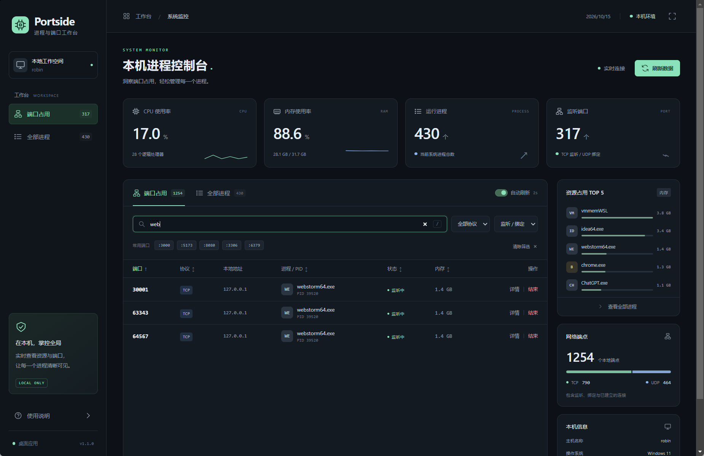

# Portside · 进程与端口工作台

Windows 本机进程与端口管理工具。通过中文面板查看系统资源、定位端口占用，并在确认后结束指定进程。

**独立桌面窗口 · 单文件 EXE · 模糊搜索 · TCP / UDP · 无需安装 Python**



## 功能

- 实时显示 CPU、内存、进程数和监听端口数，提供本次会话的资源变化曲线。
- 查看 TCP / UDP 端口、本地地址、连接状态及占用进程。
- 根据端口、PID、进程名或地址片段模糊搜索，支持精确查询。
- 按协议和状态筛选，点击表头排序，切换每页条数。
- 查看进程路径、启动命令、启动时间、所属用户及占用端口，复制详情。
- 确认后结束进程，刷新端口列表；保护 Windows 关键进程及面板运行所需进程。
- 支持最小化、最大化和 F11 全屏；重复启动唤起已有窗口，关闭窗口即退出。

## 获取和运行

适用于 Windows 10 / 11 x64，已在 Windows 11 x64 实机验证。

1. 在 [Releases](https://github.com/206069780/process-panel/releases) 中查找 `Portside.exe`。若尚未发布二进制，可按下方说明自行构建。
2. 将 EXE 保存到任意本地目录，双击打开独立窗口。只需携带这个文件，无需安装 Python 或 WebView2。
3. 查询端口或进程；需要结束进程时，先核对详情，再点击“结束”并确认。

普通权限可以查看大部分信息。提示权限不足时，关闭程序，右键 EXE 选择“以管理员身份运行”。结束进程可能丢失未保存的数据。

## 搜索示例

| 输入 | 查询方式 |
| --- | --- |
| `80` | 模糊匹配端口、PID 或进程名片段，例如 `8080`、`48080` |
| `node` | 匹配名称中包含 `node` 的进程，忽略大小写 |
| `java.exe` | 匹配包含该名称片段的进程 |
| `127.0.0.1` | 在端口视图中匹配本地或远端地址片段 |
| `:8080` | 精确匹配本地端口 `8080` |
| `pid:1234` | 精确匹配 PID `1234` |

默认只显示“监听 / 绑定”端口。需要检查已建立连接时，将状态切换为“全部状态”或“已建立连接”。模糊搜索采用字符串片段匹配，不包含拼写纠错、正则或通配符语法。

快捷键：`/` 聚焦搜索，`F11` 切换全屏，`Esc` 关闭弹窗或退出全屏。

## 从源码运行

开发建议使用 Windows x64、Python 3.12；完整测试还需要 Node.js 24。

```powershell
git clone git@github.com:206069780/process-panel.git
cd process-panel
py -3.12 -m venv .venv
.\.venv\Scripts\python.exe -m pip install -r requirements.txt
.\.venv\Scripts\python.exe main.py
```

## 构建 EXE

在 Windows x64 的项目目录执行：

```powershell
powershell -NoProfile -ExecutionPolicy Bypass -File .\build.ps1
```

脚本安装构建依赖、生成图标并通过 PyInstaller 打包，结果为 `dist\Portside.exe`。Qt 渲染组件已内置，当前文件约 201 MiB。`dist/` 不提交到 Git；二进制分发方式见[发布指南](docs/RELEASING.md)。

## 文档

| 文档 | 内容 |
| --- | --- |
| [使用指南](docs/USAGE.md) | 操作流程、查询规则、权限与常见问题 |
| [开发指南](docs/DEVELOPMENT.md) | 环境准备、目录结构、测试和打包 |
| [架构说明](docs/ARCHITECTURE.md) | 桌面窗口、数据采集、内部接口和进程保护 |
| [发布指南](docs/RELEASING.md) | 版本更新、验收、GitHub 上传与 EXE 分发 |
| [更新日志](CHANGELOG.md) | 各版本变更 |
| [贡献指南](CONTRIBUTING.md) | 问题反馈与提交要求 |
| [第三方组件](THIRD_PARTY_NOTICES.md) | 主要依赖及其许可来源 |
| [验证记录](docs/verification-2026-10-15.md) | 1.1.0 本机测试与打包验证证据 |

项目使用 Python、psutil、PySide6 / Qt WebEngine 和原生 JavaScript。应用只管理当前电脑，内部服务仅监听 `127.0.0.1`，详情见[架构说明](docs/ARCHITECTURE.md)。
