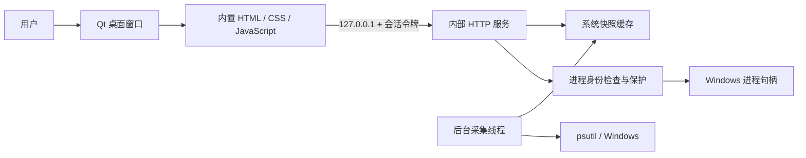

# 架构说明

## 运行结构

Portside 是本机桌面应用，使用 PySide6 的 `QMainWindow` 和 `QWebEngineView` 显示内置界面。Qt 渲染组件和 Python 随程序提供。默认便携目录中的 EXE 直接加载 `_internal` 组件；可选单文件版在运行前将组件解包到临时目录。

## 启动与退出

`main.py` 创建运行记录目录，并根据可执行文件路径、权限和运行目录获取实例互斥锁。已有实例运行时，通过 `QLocalSocket` 请求 `QLocalServer` 唤起窗口；运行记录文件缺失也不影响唤起。

主实例创建回环 HTTP 服务，启动采集线程，写入仅含 PID、启动时间、内部地址和权限状态的运行记录，然后显示窗口。Windows 使用独占端口绑定，首选端口不可用时改用系统分配的空闲端口。

`panel/window.py` 不在模块导入时加载 WebEngine。`DesktopStartup` 先绘制原生 Qt 启动画面，再在 GUI 事件循环中导入 `panel/web_window.py` 并初始化 WebEngine。创建 QApplication 前设置共享 OpenGL 属性。页面加载完成即显示主窗口并停止动画，没有固定展示时长。初始化异常会退出事件循环并向入口传播；取消启动与正常关闭共享清理流程。重复实例激活当前的启动画面或主窗口。

关闭窗口后退出 Qt 事件循环，关闭 IPC 与 HTTP 服务、释放采集线程、移除运行记录并释放互斥锁。Qt 页面先销毁，再在 GUI 线程销毁窗口及其内存配置，避免 Python 引用循环由后台线程回收时违反 Qt 的线程限制。

## 数据采集与界面

`Monitor` 默认每两秒收集进程和网络状态，使用锁保护刷新及缓存，向请求线程返回快照副本。界面轮询缓存；手动刷新会触发新的采集。关闭界面自动刷新不停止采集线程。

Windows x64 通过 `panel/win_snapshot.py` 一次批量系统查询读取进程名、创建时间、累计 CPU 和工作集，包含缓冲区、名称指针及记录步长校验。系统拒绝或格式校验失败时回退 psutil。网络连接仍由 psutil 读取。

进程身份包含 PID 和启动时间。进程内存使用 RSS 字节数，进程 CPU 按逻辑处理器数归一化到全机比例。监听数量按协议和本地端口去重，具体连接表保留不同地址和连接记录。

查询、筛选、排序和分页在 `static/model.mjs` 中执行。普通查询采用不区分大小写的片段匹配；显式 `:端口` 与 `pid:编号` 使用数值精确匹配。

## 内部接口

这些接口仅供内置界面使用，不是远程管理服务。

| 方法 | 路径 | 用途 |
| --- | --- | --- |
| GET | `/` | 返回注入当前会话令牌的界面 |
| GET | `/static/...` | 返回白名单中的静态资源 |
| GET | `/api/snapshot` | 获取缓存快照 |
| POST | `/api/refresh` | 请求新快照，请求体为 `{}` |
| GET | `/api/processes/{pid}` | 读取详情及快照中的关联连接 |
| POST | `/api/processes/{pid}/terminate` | 按 `{ "create_time": 启动时间 }` 校验身份后结束进程 |

API 要求 `X-Panel-Token`，POST 使用 `application/json`。服务校验 Host、Origin 和跨站请求标记，并限制请求体大小及静态文件范围。错误以 HTTP 状态码和 `error` 字段返回，例如 403 权限或保护限制、404 目标已退出、409 身份变化。

## 结束进程保护

面板自身、启动链中的进程、指定的 Windows 系统进程和自身 Qt 渲染进程受到保护。执行操作前再次检查 PID、启动时间和名称。

Windows 路径使用同一个进程句柄读取创建时间、查询关键进程状态并执行终止。这样即使 PID 被复用，也不会直接依赖旧快照结束另一个目标。检查失败时拒绝操作，成功后刷新快照。

## 本地数据

- EXE 运行记录：`%LOCALAPPDATA%\Portside\runtime`。
- 源码运行默认记录：项目 `.runtime/`。
- Qt 使用未命名的内存配置，禁用新窗口并将页面导航限制在当前内部地址。
- HTTP 响应禁止缓存，请求日志不记录命令行等进程详情。运行记录不包含会话令牌。
- 当前不提供远程管理、多机控制、进程历史数据库或自动更新功能。
