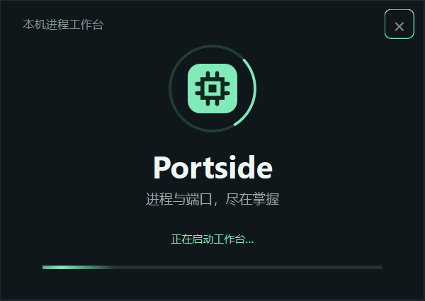

# 1.1.1 启动性能验证

本文保留 1.1.1 基准。当前版本见 [1.1.2 启动性能及验收](instant-startup-2026-10-15.md)。

日期：2026-10-15。环境：Windows 11 x64、Python 3.12、PySide6 6.10.2、PyInstaller 6.22.3、Node.js 24.18.0。

## 原因与修改

1.1.0 的单文件 EXE 启动时需要解包 568,520,307 字节的组件，原文件为 210,648,635 字节。本机解包后产生应用子进程约需 3.3 秒。

1.1.1 默认使用便携目录和 ZIP：一次解压后运行 `Portside/Portside.exe`，保留同目录 `_internal`，后续启动直接加载组件。`build.ps1 -SingleFile` 仍提供可选单文件构建。

另外修正首屏等待：当首次快照尚未就绪时，每 150ms 检查缓存；就绪后继续使用正常的两秒刷新周期。暂停自动刷新、隐藏窗口或读取失败时，不持续快速请求。

加入原生启动动画：在构建 WebEngine 主窗口前绘制启动画面，显示旋转光环、流动进度条及加载状态。页面加载完成即显示主窗口并停止动画，支持取消启动，不设置最短展示时间。



## 测量方法

`tests/startup_benchmark.py` 为每次启动隔离实例目录和 Qt 测试调试端口，记录 Windows 窗口显示、内部运行记录出现及实际页面就绪的时间。页面就绪要求显示“实时连接”、CPU 数值已加载、初始加载提示消失，并验证打包后的查询模块。每轮关闭程序并检查工作进程退出。

```powershell
.\.venv\Scripts\python.exe -m tests.startup_benchmark --exe PATH --runs 3 --max-ready-seconds 4 --output .runtime\startup-report.json
```

## 实测结果

单位为秒，均为启动到对应事件的累计时间。

| 构建 | 轮次 | 内部运行记录 | 启动动画 | 主窗口显示 | 数据界面就绪 |
| --- | --- | ---: | ---: | ---: | ---: |
| 1.1.0 单文件 | 1 | 3.748 | — | 5.607 | 6.152 |
| 1.1.0 单文件 | 2 | 3.708 | — | 5.604 | 6.154 |
| 1.1.1 便携目录 | 1 | 3.149 | 5.508 | 10.470 | 10.748 |
| 1.1.1 便携目录 | 2 | 0.346 | 2.034 | 3.296 | 3.385 |
| 1.1.1 便携目录 | 3 | 0.523 | 2.080 | 3.451 | 3.571 |

主窗口显示中位数从 5.606 秒降到 3.451 秒，减少约 38%；数据界面就绪中位数从 6.153 秒降到 3.571 秒，减少约 42%。原构建未达到本机显式设置的 4 秒中位数目标，带动画的最终便携构建通过。后两轮启动动画约 2 秒出现，随后切换至已加载页面。

本轮新包首次启动仍为 10.748 秒，动画出现也较晚。测量未清空 Windows 文件缓存，结果反映当前机器连续启动的情况；首次解压后运行、磁盘及系统负载可能带来波动，4 秒不是每次启动的保证。动画提供加载反馈，不消除 Python / Qt 导入和 WebEngine 初始化所需时间。

## 交付文件

- 启动入口：`dist/Portside/Portside.exe`，需携带完整 `Portside` 文件夹。
- 分发包：`dist/Portside-windows-x64.zip`，211,975,314 字节（约 202 MiB）。
- 完整目录：2,830 个文件，共 568,822,318 字节（约 542 MiB）。
- ZIP SHA-256：`f5e3a0b8d1061f2bd626f5f1f1c51a9b05319e9f127a3ab97a30a519661d6be1`。
- EXE SHA-256：`0b80a675091ddb2afd34a435fa1dfb7895b6515d1d7b62e1f599e4285e29a2c9`。
- 可选单文件：`dist/singlefile/Portside.exe`，210,656,025 字节；SHA-256：`913423eb3cf02c79c027c481379f7b9ad412305be17ae68cd6d794ef7a0aa365`。该模式仍需每次解包，不作为快速启动入口。

已核对 ZIP 文件清单及大小与完整目录一致，无重复条目，全部文件 CRC 检查通过。

## 回归验证

- Python unittest：34 项通过，含真实窗口切换、动画帧变化、取消、初始化异常及页面加载失败。
- Node：14 项通过，包含初次采样及时显示、就绪后停止快速请求及暂停刷新。
- 最终便携 EXE 独立验收通过：中文目录、PATH 无 Python、原生启动画面、取消启动清理、数据和模糊查询、结束测试进程并释放端口、自身及渲染进程保护、重复启动、最小化恢复、同时启动及关闭后重启。
- 最终可选单文件 EXE 运行同一套独立验收，全部通过。验收后已替换旧的可选单文件输出；旧文件保留在本地历史目录。
- 独立代码审查：目录和单文件配置、启动进程识别、首次加载轮询、基准清理和文档均已复核。

全新拷贝目录的诊断启动中，动画约 23 秒出现，主窗口约 45 秒出现，进一步说明首次运行存在较大波动。原先验收脚本在运行记录出现后仅等 15 秒，因此未等到动画便超时；改为 90 秒冷启动预算并以 10ms 间隔检查动画，不给产品增加固定展示时间。取消测试直接关闭动画，避免截图与页面切换竞争。

本地证据保存在 `.runtime/startup-baseline.json`、`.runtime/startup-animation-final.json`、`.runtime/startup-python-tests.log`、`.runtime/startup-node-tests.log` 和 `.runtime/startup-artifact-report.json`，不进入版本控制。

启动画面截图通过 Qt 控件直接导出；仓库根目录 `preview.png` 为最终打包页面的实际渲染内容，通过测试专用 CDP 截图保存，避免被其他桌面窗口遮挡。独立原生窗口的显示和退出另由 Win32 检查验证。普通运行不启用 CDP 调试端口。
